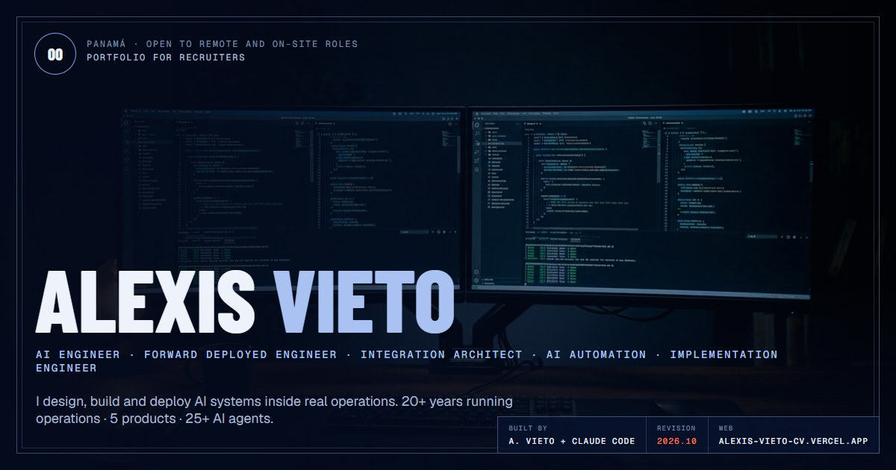

I design, build and deploy AI systems inside real operations: agents, integrations and the software around them.

Before writing software I ran engineering operations for 20+ years. I founded Proytel with $500 and grew it to $2.5M in revenue, with 40+ people, ISO 9001 and 300+ projects delivered. Today I'm the founder of **Nexera**, a SaaS company in Panama. I build products for operations that still run on Excel, and AI automation for clients.

### What I build

| Product | What it is | |
|---|---|---|
| **tino** | Multi-tenant hiring SaaS. Claude scores each CV against the job profile with cited evidence; the recruiter decides. | [contratacontino.com](https://www.contratacontino.com) |
| **Atrio** | Property management for residential buildings: resident, gate and admin apps on one backend, with double-entry accounting. | [atrioph.net](https://www.atrioph.net) |
| **NexGuard360** | ERP for private security companies: QR and GPS check-ins, live fleet tracking, payroll and daily client reports. | [nexguard360.com](https://www.nexguard360.com) |
| **NutriSoft** | Platform for nutrition clinics: patient app with live chat, online booking with Yappy payments, records and billing. 729 automated tests. | [nutri-soft-web](https://nutri-soft-web.vercel.app) |
| **Modus PM** | Project management for engineering contractors: drawing takeoff with Claude vision, tender analysis, Gantt with earned value. | Pilot |

Client code is private. Three public samples, all with tests:

- [`accounting-agents-sample`](https://github.com/alexisvieto/accounting-agents-sample): seven Claude agents keep a small company's books. The code computes the money, Postgres roles decide what each agent may write, and a person approves payments and customer messages.
- [`atrio-mcp-sample`](https://github.com/alexisvieto/atrio-mcp-sample): a read-only MCP server that lets an AI agent answer questions about a building. PostgreSQL Row Level Security decides what each person can see.
- [`atrio-ledger-sample`](https://github.com/alexisvieto/atrio-ledger-sample): a gap-free month-end ledger close that runs entirely inside PostgreSQL.

### How I work

- **AI with judgment.** Agents read, extract, score and draft. A person approves. Money and nutrition math stays in deterministic code.
- **Rules live in the database.** I use row-level security on every table, lock closed accounting periods with triggers and apply multi-tenant isolation from day one.
- **Built with Claude Code.** I define the architecture, the data model and the security, and I review and test every change.

**Stack:** TypeScript · Python · PostgreSQL / Supabase · React / Next.js · React Native (Expo) · Claude API, tool use and MCP · Vercel

### Links

[Portfolio for recruiters](https://alexis-vieto-cv.vercel.app) · [Services](https://alexis-vieto.vercel.app) · [LinkedIn](https://www.linkedin.com/in/alexis-vieto) · alexisvieto@gmail.com

<b>En español</b>

 

Diseño, construyo y despliego sistemas con IA dentro de operaciones reales: agentes, integraciones y el software que los rodea.

Antes de escribir software dirigí operaciones de ingeniería por más de 20 años. Fundé Proytel con 500 dólares y la llevé a facturar 2.5 millones, con más de 40 personas, ISO 9001 y más de 300 proyectos entregados. Hoy soy fundador de **Nexera**, una empresa de SaaS en Panamá. Construyo productos para operaciones que todavía viven en Excel y automatización con IA para clientes.

Mis productos son **tino** (selección de personal), **Atrio** (propiedad horizontal), **NexGuard360** (seguridad privada), **NutriSoft** (clínicas de nutrición) y **Modus PM** (proyectos de ingeniería). Los agentes leen, extraen y redactan, y una persona aprueba. Las reglas de negocio y la seguridad viven en la base de datos.

[Portafolio para reclutadores](https://alexis-vieto-cv.vercel.app) · [Servicios](https://alexis-vieto.vercel.app) · [LinkedIn](https://www.linkedin.com/in/alexis-vieto)

